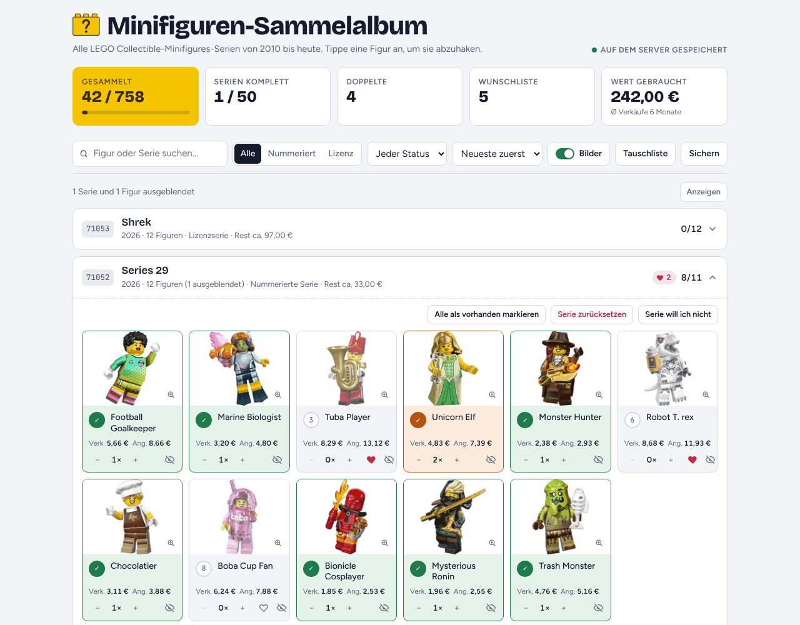
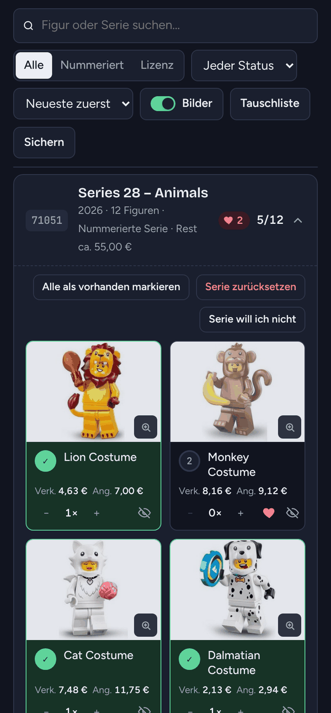
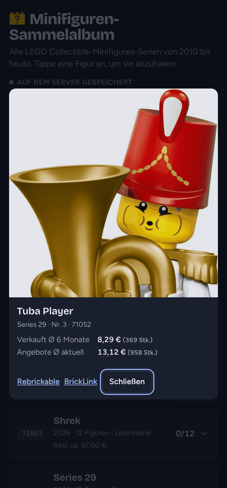
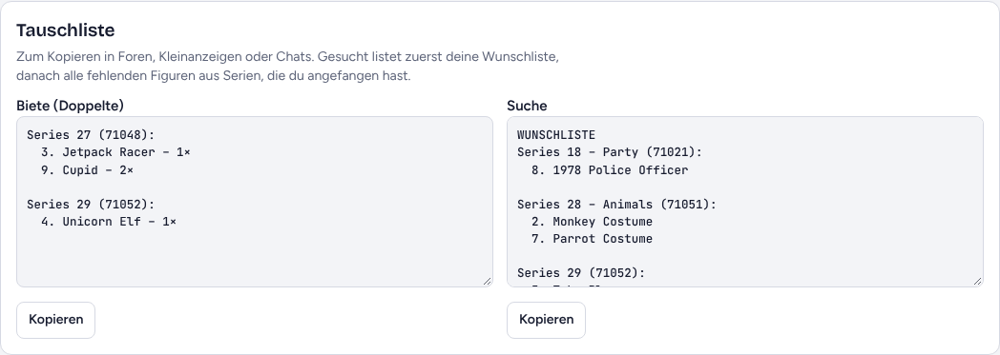

# Minifiguren-Sammelalbum

[](https://buymeacoffee.com/quentyn83)

Sammel-Tracker für alle LEGO Collectible-Minifigures-Serien (51 Serien, 775 Figuren, Stand 10/2026),
mit Bildern, Wunschliste, Doppelten, Tauschliste, BrickLink-Preisen und automatischer
Erkennung neuer Serien.

Ein Container, keine Datenbank: die Sammlung liegt als `data/state.json` im Bind-Mount,
plus tägliche Sicherungen unter `data/backups/` (die letzten 30 Tage).

## Screenshots



<p>
  
  &nbsp;
  
</p>



<sub>Die Screenshots zeigen eine Beispielsammlung mit Beispielpreisen.</sub>

## Funktionen

- Alle Serien von Series 1 (2010) bis heute, nummerierte und Lizenzserien
- Abhaken per Tipp, Doppelte zählen, Wunschliste
- Fotos jeder Figur (Rebrickable) mit Großansicht
- BrickLink-Preise gebraucht: Ø Verkäufe der letzten 6 Monate und Ø aktuelle Angebote,
  dazu Sammlungswert und Restkosten pro Serie
- Serien oder einzelne Figuren ausblenden, die man nicht sammeln will
- Tauschliste zum Kopieren, Export und Import der Sammlung
- Neue Serien erscheinen automatisch, sobald sie im Rebrickable-Katalog stehen
- Für Handy und Desktop, mit hellem und dunklem Design

## Installation

Bei jedem Push auf `main` baut GitHub Actions das Image und legt es unter
`ghcr.io/qu3ntyn83/minifig-album:latest` ab.

```bash
sudo git clone https://github.com/Qu3ntyn83/minifig-album.git /opt/minifig-album
cd /opt/minifig-album
sudo mkdir -p data && sudo chown -R 1000:1000 data
sudo docker compose pull && sudo docker compose up -d
curl -s http://localhost:3020/healthz   # -> {"ok":true}
```

Die App läuft dann unter `http://<server-ip>:3020`. Port und Pfad lassen sich in
`docker-compose.yml` anpassen.

## Zugriff von außen

Die App hat keine eigene Anmeldung. Soll sie aus dem Internet erreichbar sein, gehört ein
Reverse Proxy mit Anmeldung davor. Ein Beispiel für Caddy mit `basic_auth` steht in
`Caddyfile.snippet`:

```bash
docker exec caddy caddy hash-password --plaintext 'DEIN-PASSWORT'
# Hash, Domain, Benutzer und Ziel im Snippet eintragen und in dein Caddyfile übernehmen
docker exec caddy caddy reload --config /etc/caddy/Caddyfile
```

Hängt Caddy im selben Docker-Netzwerk, kannst du statt der IP auch
`reverse_proxy minifig-album:3000` nutzen und das Port-Mapping weglassen.

## BrickLink-Preise (optional)

Pro Figur zeigt die App zwei Werte aus dem BrickLink-Preisführer, jeweils **gebraucht**
für die Minifigur ohne Ständer (BrickLink-Nummer wie `col312`):

- **Verk.**: Durchschnittspreis der Verkäufe der letzten 6 Monate
- **Ang.**: Durchschnittspreis der aktuellen Angebote

Dazu den Sammlungswert und pro Serie, was das Vervollständigen ungefähr kostet.

Einrichtung:

1. Auf BrickLink einloggen und unter https://www.bricklink.com/v2/api/register_consumer.page
   einen API-Zugang anlegen.
2. Einen Access Token erzeugen. Als IP die öffentliche IP eintragen, von der dein Server
   ins Internet geht.
3. Auf dem Server:
   ```bash
   cd /opt/minifig-album && sudo cp .env.example .env && sudo nano .env   # 4 Werte eintragen
   sudo docker compose up -d
   sudo docker logs -f minifig-album   # zeigt den Fortschritt
   ```

Meldet das Log `TOKEN_IP_MISMATCHED`, steht dort die IP, die BrickLink gesehen hat. Diese
beim Access Token eintragen.

Der erste Durchlauf dauert gut eine halbe Stunde (2 Abfragen pro Figur, mit Pause dazwischen).
Danach werden die Preise wöchentlich aufgefrischt. BrickLink erlaubt 5.000 Abfragen pro Tag,
die App nutzt höchstens 4.000. Der Cache liegt in `data/prices.json`.

## Neue Serien

Der Server prüft einmal täglich den öffentlichen Rebrickable-Katalog. Taucht dort eine
neue Collectible-Minifigures-Serie auf (mindestens 6 Einzelfiguren), erscheint sie
automatisch in der App, mit Bildern und, soweit über Brickset auffindbar, mit
BrickLink-Nummer für die Preise. Der Cache liegt in `data/catalog.json`.

- `CATALOG_SKIP`: Setnummern, die ignoriert werden (Standard: `71049`, die F1-Rennwagen)
- `CATALOG_CHECK_HOURS`: Prüfintervall in Stunden (Standard: 24)

## Update

```bash
cd /opt/minifig-album && sudo git pull && sudo docker compose pull && sudo docker compose up -d
```

Oder automatisch mit einem Container-Updater wie Watchtower.

## Sicherung

Den Ordner `data/` in dein Backup aufnehmen. Zusätzlich gibt es in der App unter
„Sichern“ einen Export als Text.

## Mitwirkende

- [Torsten Weise](https://github.com/Qu3ntyn83) (@Qu3ntyn83): Idee, Betrieb und Weiterentwicklung

Fehler und Wünsche gern als [Issue](https://github.com/Qu3ntyn83/minifig-album/issues).

## Unterstützen

Wenn dir das Projekt hilft und du mir einen Kaffee ausgeben möchtest, freue ich mich sehr:

<a href="https://buymeacoffee.com/quentyn83"></a>

## Lizenz

[MIT](LICENSE) – Torsten Weise
